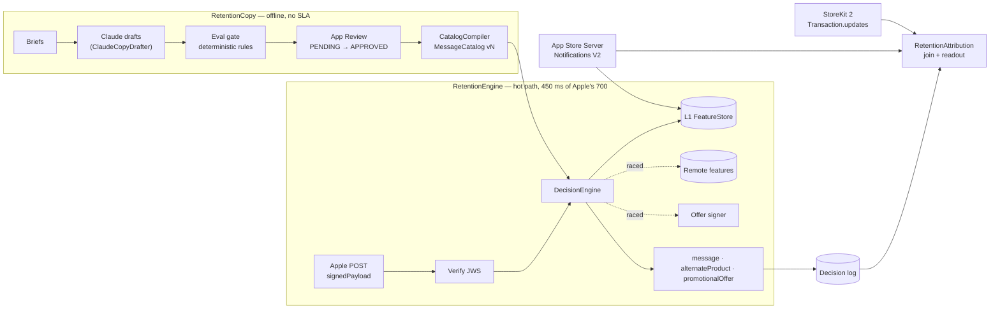

# RetentionDecisionKit

**Apple gives your server 700 ms to decide what a cancelling subscriber sees. This kit answers inside that window every time — and keeps the LLM nowhere near it.**

A reference implementation of the server behind Apple's new real-time **Retention Messaging API**: a deadline-budgeted decision engine, notification-fed feature store, intent-to-treat holdout, an offline Claude copy pipeline with a deterministic App Review gate, and the attribution that tells you whether any of it worked. Swift 6 (strict concurrency), no dependencies, Linux and Apple platforms.

> **Demo app:** (added after the companion repo is pushed — see below)

---

## Why this matters

On **4 November 2026** Apple made retention messages available for subscriptions ([Apple Developer News](https://developer.apple.com/news/?id=fk9ps3gv)). The App Store can now show a message — text, a switch-plan suggestion or a promotional offer — in the cancellation flow. With the [Retention Messaging API](https://developer.apple.com/documentation/retentionmessaging/) in real-time mode, the App Store server calls *your* Get Retention Message endpoint and you choose what the subscriber sees. Apple's documentation is blunt about the constraint:

> *"Your endpoint needs to respond within 700 ms in the production environment; otherwise, the App Store server times out and the request fails."*
> — [Setting up your Get Retention Message endpoint](https://developer.apple.com/documentation/retentionmessaging/setting-up-retention-messaging-endpoint)

That one endpoint is four staff-level problems at once:

| Problem | Why it's hard |
|---|---|
| **A hard latency SLA** | 700 ms *includes* the network and TLS on both legs. Every dependency — a cache, a signer, signature verification — must be bounded, including the ones that hang and ignore cancellation. |
| **Personalization without lookups** | Beyond who and where (`originalTransactionId`, `productId`, `userLocale`), the request tells you nothing about the subscriber. Everything else must already be in memory, kept current by App Store Server Notifications that arrive late, twice, or out of order. |
| **An experiment** | Without a holdout you cannot tell a good message from a cancellation that was never going to happen. |
| **Copy at scale, under review** | Every message must be uploaded and **approved** by Apple before it can be shown — so generative AI belongs in an offline pipeline with a gate, never in the request. |

## Architecture



| Module | Responsibility | Depends on |
|---|---|---|
| `RetentionEngine` | Wire types, JWS parsing, the deadline race, feature store, offer policy, catalog, `DecisionEngine`, framework-agnostic `RetentionEndpoint`, latency histogram, open/closed-loop load harness | — |
| `RetentionCopy` | `CopyDrafter` (Claude Messages API adapter + scripted stand-in), `CopyEvalGate`, `VariantRanker`, `CatalogCompiler`, `CopyPipeline` | `RetentionEngine` |
| `RetentionAttribution` | `AttributionEngine` (last-touch join of decisions to facts), `ExperimentReadout` (Wilson / Newcombe intervals), StoreKit 2 mapping | `RetentionEngine` |
| `RetentionLab` | The demo's scenarios (platform-agnostic, unit-tested) and SwiftUI views | all three |

The dependency arrows are the point: **the hot path cannot link the LLM pipeline.** `RetentionCopy` produces a `MessageCatalog`; `RetentionEngine` only reads one.

## Guarantees, and the test that holds each one

| Guarantee | How | Proven by |
|---|---|---|
| **Never later than the budget** — even when a dependency hangs *and ignores cancellation* | Every await is raced with `raceDeadline`, which runs the operation in an unstructured task and resumes the caller at the deadline. Everything after the last await is synchronous. | `testNeverLaterThanTheBudgetAcrossDeadlineBoundaries` — 42 scenarios on a manual clock: a local subscriber with each of 7 signer behaviours, and a remote one with each of 5 lookup × 7 signer behaviours (instant, finishing just either side of the 360 ms lookup and 440 ms signing deadlines, or hung and deaf to cancellation). Each outcome is predicted, and the delivery instant is read from the clock. Also `testHungRemoteFallsBackExactlyAtTheLookupDeadline` (exactly 360 ms). |
| …and the obvious implementation can't do that | A `withTaskGroup` race waits for every child before returning; `cancelAll()` only *asks*. | `testTaskGroupRaceIsHeldOpenByNonCooperativeChild` — the broken version, shipped in the tests, fails the property |
| **Fails safe, explicitly** | A `MessageCatalog` cannot exist (built or decoded) without a safe-fallback and control message for every product/locale it serves, and `CatalogCompiler` refuses fallbacks Apple has not `APPROVED` — Apple displays nothing else. | `testCatalogRefusesEntriesItCannotFailSafeFor`, `testCatalogCodableRoundTripRevalidates`, `testFallbacksMustBeApproved` |
| **Degrades in order, never skips an offer** | Each cell is ranked within its kind, then concatenated offer → switch plan → text; an ineligible or unsignable offer falls through with no extra I/O. | `testRankingNeverPutsTextAheadOfAnOffer`, `testIneligibleOfferFallsThroughToSwitchPlan`, `testSlowSignerDegradesAtTheSigningDeadline` |
| **A degraded remote costs nothing** | The breaker opens after consecutive failures or timeouts (a miss is an answer, not a failure); half-open admits one probe, which an exhausted request never spends. | `testBreakerOpensAndStopsCallingTheRemote`, `testTimeoutsOpenTheBreaker`, `testRemoteMissAndAbsentRemoteBothFallBack`, `testExhaustedRequestDoesNotConsumeTheHalfOpenProbe` |
| **Idempotent per request** | Concurrent duplicates share one pipeline run (in-flight map registered before the first suspension); later ones hit a bounded replay cache. Both are keyed by `requestIdentifier` *and* the request's content minus `signedDate`, so a re-signed copy replays while a different request that reuses the identifier is decided — and attributed — on its own. | `testConcurrentDuplicatesShareOnePipelineRun`, `testSequentialDuplicateIsReplayedEvenIfAFreshDecisionWouldDiffer`, `testSameIdentifierForADifferentSubscriberIsNotReplayed`, `testReplayCacheIsBounded` |
| **Notification order and duplicates can't corrupt state** | Features are a join: per-field last-writer-wins on `(signedDate, notificationUUID)`, a minimum, a bounded most-recent set. | `testMergeIsOrderIndependentAcrossAllPermutations` (all 720 orders), `testTenureStartsAtTheEarliestPurchase`, `testDecodingRestoresTheRedemptionInvariants`; `testCheckerCatchesArrivalOrderFold` is a control showing the same checker rejects a naive fold |
| **The holdout is intent-to-treat, and measured** | Assignment is FNV-1a of `(salt, originalTransactionId)` — never `Hasher` — and happens before any lookup. Holdout decisions are attributed like treatment ones, so the readout can compare the arms. | `testHoldoutGetsControlWithoutAnyLookup`, `testHoldoutBoundaryIsExclusive`, `testFNV1aGoldenVectors`, `testBothArmsAreAttributedAndCompared` |
| **Typography can't slip copy past the gate** | Phrase rules match after folding case, diacritics and width; apostrophe variants become `'`; hyphens and every space, line or paragraph separator become one space; default-ignorable characters are dropped. Line separators are also rejected outright, like newlines. | `testTypographyIsNotAWayAroundThePhraseRules`, `testEachKnownMistakeIsCaughtByExactlyItsOwnRule` |
| **No trap is reachable from a request** | Saturating arithmetic for every external number; `Int(Double)` and `Duration` conversions only through clamping helpers; every configuration value clamped once — decoded ones too, since decoding goes through the clamping initializers; arrivals older than Apple's timeout are charged as exactly 700 ms. | `testSaturatingArithmeticNeverTraps`, `testDurationConversionsSaturateInsteadOfTrapping`, `testExtremeInputsDoNotTrap`, `testConfigurationClampsEverything`, `testDecodingGoesThroughTheClamps`, `testArrivalOlderThanAppleTimeoutIsClamped` |
| **p99 is measured honestly** | Open-loop load is timed from each request's *intended* start, so a stalled server — or a stalled load generator — shows up in the tail; a closed-loop run of the same traffic is reported next to it. | `testOpenLoopChargesAnIssuerStallToTheRequestsItDelayed`, `testOpenLoopSeesTheStallClosedLoopHides`, `testReportCountsAnswersLaterThanApple` |
| **The tests guard the claims above** | `scripts/mutation-check.sh` applies 29 mutants, each breaking one behaviour and naming the test that must catch it. A mutant counts only if *that* test fails, and a comment-only control mutant must survive, which proves every restored file was rebuilt. | the CI `mutation` job |

## Design decisions and trade-offs

**1. A 450 ms budget, not 700.** Apple's timer runs from its side, so the default leaves 250 ms for TLS and the network, and the request's arrival time is charged to the budget (pass `receivedAt` stamped at the socket). The 250 ms also absorbs timer lateness: deadlines are exact on the manual clock the tests use, but on a real clock a race resumes when the scheduler wakes it — in the demo's screenshot a hung lookup, cut at 360 ms on paper, is answered at 379 ms. *Rejected:* using the full 700 ms — a single slow network leg turns a correct decision into Apple's fallback.

**2. Precompute the expensive part, evaluate the time-dependent part.** Notifications fold into per-subscriber features ahead of time; tenure, cool-downs and segments are evaluated per request from the Apple-signed `signedDate`, so the same request always yields the same decision. *Rejected:* precomputing the whole decision (a subscriber crosses a tenure boundary with no notification); computing from transaction history on request (an App Store Server API call inside the 700 ms).

**3. Race without waiting for the loser.** The remote lookup and the offer signer may hang in ways that ignore cancellation — a blocking driver, a retry loop, a continuation nobody resumes. `raceDeadline` returns at the deadline regardless and drops the late result. *Trade-off:* the loser keeps running until it finishes on its own, so remote clients still need their own timeouts to bound resource use.

**4. An explicit safe fallback instead of a timeout.** When the personalized path can't finish, the engine answers with the product's approved safe-fallback message. Apple would also fall back on a timeout — but then nobody knows what the subscriber saw, and the decision can't be attributed. When nothing approved exists for a product/locale the endpoint answers `404`, and Apple falls back as it does for any failed request: to the message configured in App Store Connect for the subscription, then to the default message for the product and locale, and otherwise shows none. *Rejected:* returning `5xx` on a slow lookup.

**5. Graceful degradation down a ranked list.** Each catalog cell is an ordered list: variants are ranked within their kind (Wilson lower bound, with exploration slots for unproven ones), then concatenated offer → switch plan → text. Text is always usable, so ranking across kinds could put a text message first and make every offer behind it unreachable. An ineligible or unsignable offer falls through to the next entry with no extra I/O. *Trade-off:* a cell's order is decided offline; per-request ranking would need features the hot path deliberately doesn't fetch.

**6. Join-based ingestion instead of "dedupe, then apply in order".** App Store Server Notifications are retried and can arrive out of order. A commutative, idempotent merge makes both irrelevant and needs no ever-growing set of seen UUIDs. *Trade-off:* every field needs a merge rule; "the latest notification wins" is not one.

**7. Intent-to-treat holdout, decided first.** A treatment subscriber whose lookup timed out still counts as treatment. *Rejected:* assigning after eligibility, which quietly drops the subscribers whose dependencies failed and biases the comparison.

**8. Sharded locks for L1.** One lock per shard, one dictionary operation per critical section; batch ingestion releases the lock between facts. *Rejected:* an actor (reads queue behind a ten-thousand-fact backfill) and snapshot swapping (an O(n) copy per batch).

**9. A circuit breaker on the remote source.** When the cache is degraded, every miss would otherwise cost a full timeout and push p99 to the budget while piling retries onto a struggling dependency. Open, the engine serves the fallback immediately; half-open admits exactly one probe — and an exhausted request never consumes it.

**10. The LLM writes offline, and a deterministic gate decides.** Apple requires every message to be approved before display, so generation on request is impossible as well as slow. `ClaudeCopyDrafter` forces a `submit_variants` tool call for structured output; the gate re-checks everything (length in UTF-16 units against Apple's 66/144 limits, invisible characters, urgency and guilt phrasing in five languages — matched after folding typography such as curly apostrophes and no-break spaces — hardcoded prices, discounts that don't match the attached offer, numbers not grounded in the brief, script mismatches). An optional `CopyJudge` can **veto** what passes, never rescue what fails. Message identifiers are content-addressed (RFC 9562 v8 UUIDs), because Apple's Upload Message endpoint is not idempotent. Only `APPROVED` messages are compiled into the catalog. *Rejected:* an LLM judge as the only gate (not reproducible, not explainable).

**11. A request is an eligibility event, not an exposure.** Apple calls the endpoint when a subscriber *views* subscription details and shows the message only if they tap Cancel, so most requests come from people who were never going to cancel. Absolute "save rates" per request are therefore meaningless; the readout's headline is **cancellations prevented = holdout cancellation rate − treatment cancellation rate**, per subscriber, with Wilson and Newcombe 95% intervals. *Rejected:* save rate per request.

**12. Build vs buy.** Verifying Apple's JWS certificate chain and signing promotional offers are *buy*: `SignedPayloadVerifier` and `OfferSigner` are protocols meant to wrap Apple's App Store Server Library. The server framework is *neither*: `RetentionEndpoint` maps request bytes to status and response bytes, so it mounts in Vapor, Hummingbird or a Lambda handler in a few lines.

## Using it

```swift
import RetentionEngine

let configuration = EngineConfiguration(
    appAppleId: 1_234_567_890,
    environment: .production,
    responseBudget: .milliseconds(450),
    experiment: ExperimentAssigner(salt: "retention-2026-11", holdoutBasisPoints: 1_000)
)
let store = FeatureStore()
let catalog = CatalogHolder(try JSONDecoder().decode(MessageCatalog.self, from: compiledCatalogJSON))
let engine = DecisionEngine(
    configuration: configuration,
    catalog: catalog,
    store: store,
    remote: myRedisFeatureSource,      // any FeatureSource; raced against the budget
    signer: myPromotionalOfferSigner,  // wraps Apple's App Store Server Library
    sink: myDecisionLogShipper         // must not block
)
let endpoint = RetentionEndpoint(engine: engine, verifier: myAppleJWSVerifier)  // shares the engine's clock

// In your HTTP handler — stamp arrival on the engine's clock, as early as you can:
let arrival = engine.clock.now()
let response = await endpoint.handle(body: requestBody, receivedAt: arrival)
// → response.status and response.body

// In your App Store Server Notifications V2 handler, after verifying the notification:
if let fact = SubscriptionFact(summary) { store.ingest(fact) }

// Daily: forget subscriptions that ended longer ago than your offer cool-down (UNIX ms).
store.compact(inactiveBefore: nowMilliseconds - 90 * 86_400_000)
```

Offline, on a schedule:

```swift
import RetentionCopy

// URLSessionTransport is Apple-only; on Linux, implement HTTPTransport (one method) over your HTTP client.
let drafter = ClaudeCopyDrafter(model: "<the model you evaluated>", apiKey: { try secret("ANTHROPIC_API_KEY") }, transport: URLSessionTransport())
let report = await CopyPipeline(drafter: drafter).run(briefs)
let compiled = try CatalogCompiler().compile(
    drafts: report.drafts,
    states: appleMessageStates,    // from Get Message List
    productLocales: fallbacks,     // human-owned; throws .fallbacksNotApproved until Apple approves them
    fallbackCopy: fallbackCopy,    // lets that error carry the uploads still to make
    primaryLocale: "en-US"
)
// Upload compiled.uploads with Apple's Upload Message endpoint; publish compiled.catalog to the servers.
```

Run it locally:

```sh
swift build -Xswiftc -warnings-as-errors
swift test
bash scripts/mutation-check.sh   # every mutant caught by its named test; 15–30 minutes on two cores
```

Install:

```swift
.package(url: "https://github.com/rajatslakhina/retention-decision-kit.git", from: "1.0.0")
```

## What this kit deliberately does not do

- **No X.509 path validation or ES256 signing.** Those are protocols; production wraps Apple's App Store Server Library. `InsecureAcceptAnyVerifier` exists for tests and the demo only.
- **Not the whole path to production.** Apple grants Retention Messaging API access by request, and the endpoint must pass Apple's *Initiate Performance Test* in the sandbox before it can be configured for production — the open-loop harness is the place to rehearse for it, but nothing here calls it. A valid certificate and TLS 1.2 are the host's job.
- **Text messages only.** Apple's messages can also carry an image; the catalog and the copy pipeline handle header and body text.
- **The gate checks for the mistakes models make, not for an adversary.** It folds typography so ordinary output can't slip past a phrase list, but it is no defence against deliberate homoglyph spoofing; Apple's own review still applies to every message.
- **No calls to Apple's management endpoints.** The compiler produces an upload plan; executing it (Upload Message, Get Message List, Configure Default Message) is the host's job.
- **One process's memory.** L1 is per instance; multi-instance freshness comes from fanning notifications out to every instance or from the shared remote source.
- **L1 grows with every subscriber it has seen** — about 1 KB each, measured (RSS on Linux, 200,000 subscribers with three to five facts each). `FeatureStore.compact(inactiveBefore:)` drops subscriptions that ended before a cutoff; run it on a schedule. There is no size cap: an L1 that evicts live subscribers would turn hits into remote lookups at the worst moment.
- **`ClaudeCopyDrafter` is tested against a stub transport**, not the live API — CI has no API key, by design.
- **The StoreKit 2 mapping compiles on Apple platforms but has no unit test**; exercising it needs a StoreKit test session.

## Verification

What was run for this release, exactly:

| Check | Environment | Result |
|---|---|---|
| Clean build, `-warnings-as-errors` | Linux x86_64, Swift 6.0.3 | ✅ |
| `swift test` | Linux x86_64, Swift 6.0.3 | ✅ 141 tests, 0 failures |
| Clean build, `-warnings-as-errors` | macOS, Xcode 27.2 / Swift 6.4.2 | ✅ |
| `swift test -Xswiftc -warnings-as-errors` | macOS, Xcode 27.2 / Swift 6.4.2 | ✅ 141 tests, 0 failures |
| `xcodebuild build -scheme RetentionDecisionKit-Package` for `generic/platform=iOS Simulator` (all four products, including the SwiftUI lab and the StoreKit 2 mapping) | Xcode 27.2 | ✅ |
| `scripts/mutation-check.sh` | Linux x86_64, Swift 6.0.3 | ✅ 29 of 29 mutants caught, each by its named test; the control survived |
| Demo app on a Simulator | iOS 27.2 Simulator, iPhone 18 Pro | ✅ launched and screenshotted headlessly (`xcodebuild` + `simctl`, launch arguments, no taps), built against a local checkout of this kit — see the [demo repo](https://github.com/rajatslakhina/retention-decision-demo-app#verification) |

**CI** runs three jobs on pushes to `main`, on `v*` tags, on pull requests and on manual dispatch: Linux (`swift:6.0` container: build with warnings as errors, test), Apple (`macos-15`: build with warnings as errors, test, iOS Simulator build of every product) and the mutation check. CI had not run when this README was written — the repository was not public yet; see the [Actions tab](../../actions) for its history.

## License

MIT
